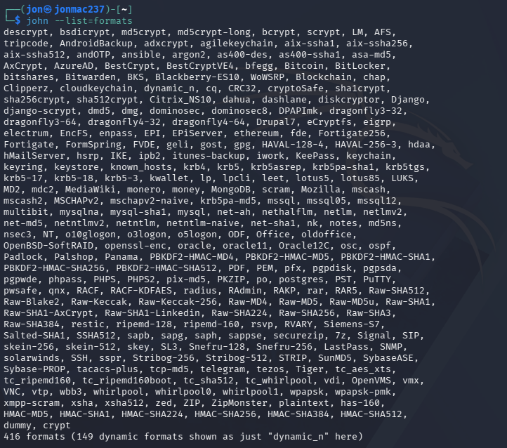
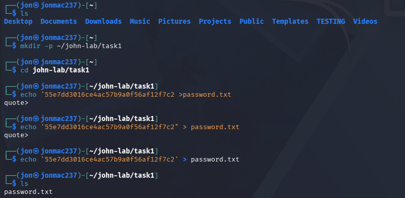
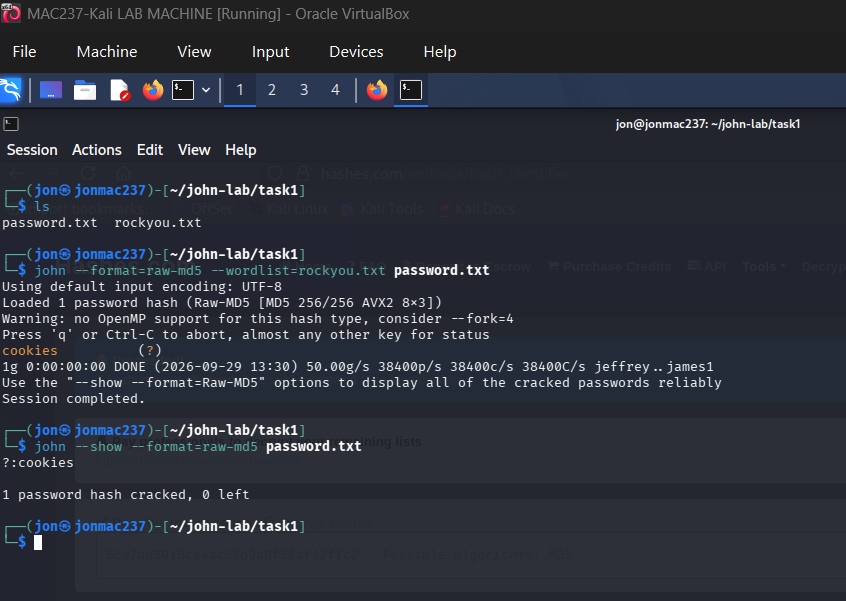
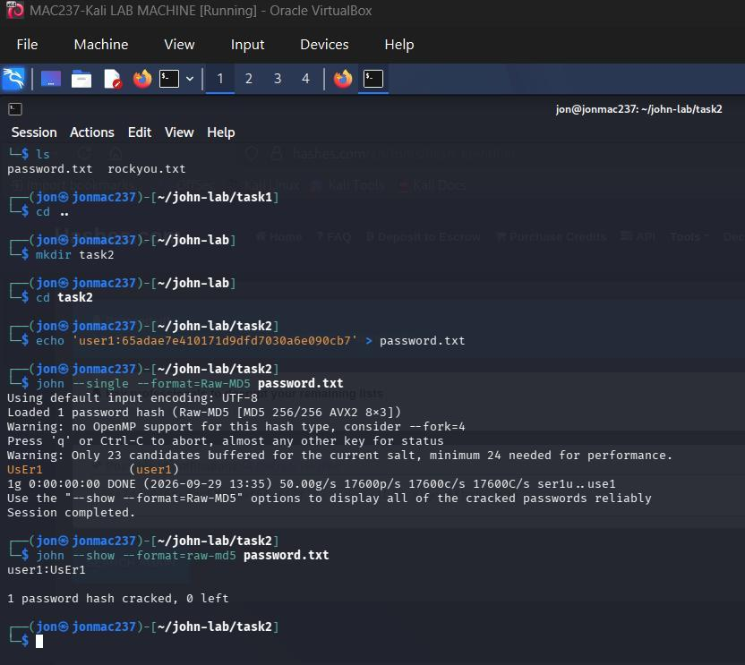
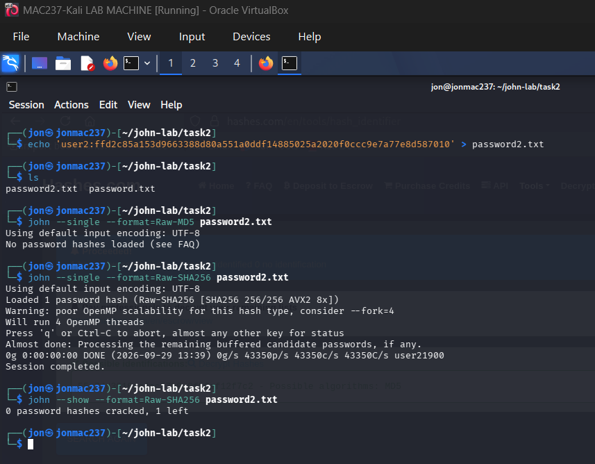
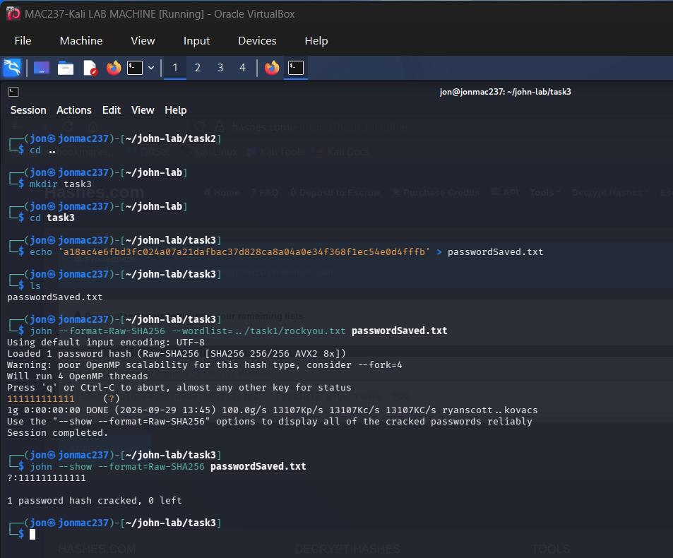

# John the Ripper Password Auditing Lab

By **NGGAPLZ**. An offline password-auditing exercise in a Kali Linux VM using
provided lab hashes. The work compares single-crack and wordlist modes, records
an unsuccessful attempt, and explains why selecting the right hash format matters.

The screenshots and results below come from the original coursework. John was
not rerun during repository preparation. Use only your own or explicitly
authorized test hashes. No real account credentials or leaked wordlists are included.

## Recorded results

| Exercise | Format and mode | Original result |
|---|---|---|
| Supplied digest | Raw-MD5, wordlist | Recovered the lab word `cookies` |
| Lab account user1 | Raw-MD5, single | Recovered `UsEr1`, including its capitalization |
| Second lab account | Raw-SHA256, single | Zero cracked; one remained |
| Saved lab digest | Raw-SHA256, wordlist | Recovered `111111111111` (twelve ones) |

### Format selection

The original environment listed 416 formats with `john --list=formats`; this count
is specific to that build. A digest's shape suggests possible formats but does
not uniquely identify its algorithm. The successful Raw-MD5 match established
the first sample's interpretation in this exercise.



### MD5 wordlist test

The original digest was `55e7dd3016ce4ac57b9a0f56af12f7c2`.
The submitted workflow created a local hash file and ran:

```sh
john --format=raw-md5 --wordlist=rockyou.txt password.txt
john --show --format=raw-md5 password.txt
```




### Single-crack mode and troubleshooting

Single mode uses account-related information and candidate transformations.
In the first example, it recovered `UsEr1` for the lab username `user1`.

```sh
john --single --format=Raw-MD5 password.txt
john --show --format=raw-md5 password.txt
```



For the second account, the initial Raw-MD5 selection loaded no hashes. Switching
to Raw-SHA256 loaded the hash but produced no match. Correct format selection
fixes parsing; it does not guarantee that the candidate set contains the password.
The unsuccessful result does not establish that the password is uncrackable.



### SHA-256 wordlist test

```sh
john --format=Raw-SHA256 --wordlist=../task1/rockyou.txt passwordSaved.txt
john --show --format=Raw-SHA256 passwordSaved.txt
```

The evidence records one recovered hash and zero remaining.



## Lessons

Wordlist mode tries supplied candidates; single mode uses account-derived
candidates and rules. Incremental mode explores candidates within its configured
character/length constraints, and the search space grows rapidly. A salt separates
work across differently salted hashes; it does not make a weak password strong.
These distinctions are described in the [official mode documentation](https://www.openwall.com/john/doc/MODES.shtml).

"No password hashes left to crack" can indicate that the pot file already contains
a result. Inspect the saved result with `--show` before interpreting the message
as an error. No pot files or session files are committed to this repository.

## Small reproducible fixture

The `samples` directory contains newly prepared, openly known **demo data**, not
an export of accounts. It allows a small wordlist demonstration without downloading
the original large wordlist. In an environment with a compatible John Jumbo build:

```sh
john --format=raw-md5 --wordlist=samples/demo-words.txt samples/md5.txt
john --show --format=raw-md5 samples/md5.txt
john --format=raw-sha256 --wordlist=samples/demo-words.txt samples/sha256.txt
john --show --format=raw-sha256 samples/sha256.txt
```

Expected words are `cookies` and `111111111111` respectively. These are expected
fixture outcomes, not new John execution results. Use `python verify_fixtures.py`
to verify the sample digests with Python's standard library.

Original local usernames and machine names remain in screenshots with the
owner's approval. Professor names, personal author text, course headings and PDF
metadata have not been carried into this repository. No license has been selected.
